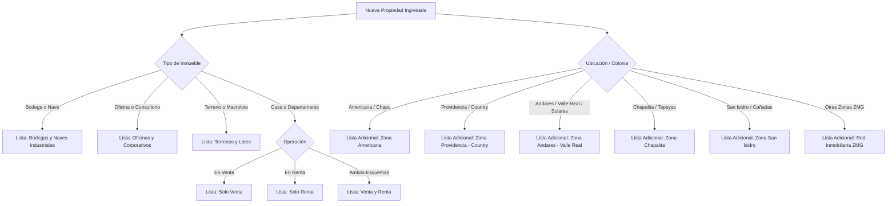
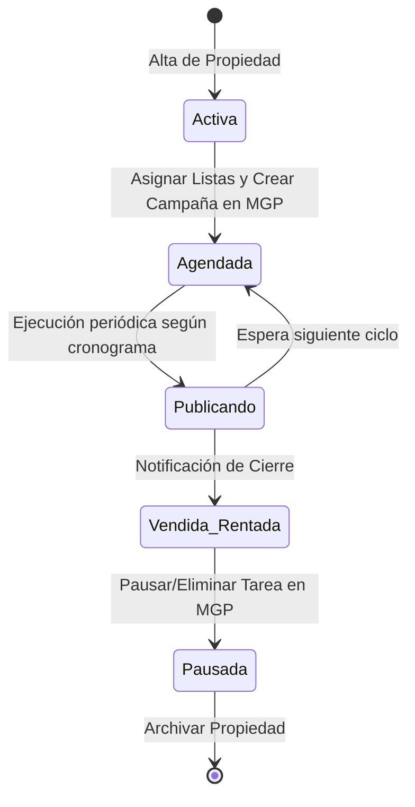

# Manual de Operaciones: Agente Automatizado de Publicación en Facebook con Multigroup Poster

## 1. Visión General del Sistema
Este documento establece el protocolo operativo para el **Agente Inmobiliario Autónomo** encargado de gestionar y programar publicaciones periódicas de la cartera de propiedades en Facebook Groups utilizando la extensión **Multigroup Poster (MGP)**.

El objetivo es mantener una presencia constante, rotativa y orgánica en las audiencias correctas de la Zona Metropolitana de Guadalajara (ZMG), minimizando el riesgo de sanciones o restricciones por parte del algoritmo de Facebook y garantizando que cada propiedad tenga visibilidad continua hasta su venta o renta efectiva.

---

## 2. Inventario de Listas Configuradas en Multigroup Poster

Las listas generadas en el archivo [`listas_para_multigroup_poster.json`](file:///Users/mac/Documents/MGP%20Prospeccion/listas_para_multigroup_poster.json) deben cargarse en la extensión con las siguientes etiquetas:

| ID Lista | Nombre de la Lista en MGP | Capacidad | Enfoque Principal |
| :--- | :--- | :---: | :--- |
| `LST-VTA` | **1. Solo Venta (Inmuebles ZMG)** | 58 grupos | Casas, residencias y departamentos en venta. |
| `LST-MIX` | **2. Venta y Renta (Inmuebles ZMG)** | 44 grupos | Propiedades con esquema dual o mercado mixto. |
| `LST-TER` | **3. Terrenos y Lotes (Jalisco / ZMG)** | 28 grupos | Terrenos habitacionales, comerciales, campestres y macro-lotes. |
| `LST-OFI` | **4. Oficinas y Corporativos** | 9 grupos | Oficinas, consultorios médicos, coworking y pisos ejecutivos. |
| `LST-BOD` | **5. Bodegas y Naves Industriales** | 18 grupos | Bodegas comerciales, naves industriales y predios logísticos. |
| `LST-AME` | **6. Zona Americana - Chapultepec - Lafayette** | 8 grupos | Propiedades céntricas, patrimonio, airbnb, departamentos en Col. Americana. |
| `LST-PRO` | **7. Zona Providencia - Country Club - Colomos** | 14 grupos | Segmento medio-alto y residencial premium en Providencia y Country. |
| `LST-AND` | **8. Zona Andares - Puerta de Hierro - Valle Real - Solares** | 15 grupos | Zona poniente de Zapopan y alta plusvalía. |
| `LST-CHA` | **9. Zona Chapalita - Ciudad del Sol** | 7 grupos | Residencias y depas en el cuadrante Chapalita / Tepeyac / La Calma. |
| `LST-ISID` | **10. Zona San Isidro - Cañadas - Centinela** | 6 grupos | Zona norte de Zapopan. |
| `LST-RNT` | **11. Solo Renta (Departamentos y Casas)** | 41 grupos | Arrendamientos residenciales tradicionales o amueblados. |
| `LST-B2B` | **12. Inmobiliarios Generales y Asesores ZMG** | 76 grupos | Colaboración y bolsa inmobiliaria compartida con colegas. |

> [!CAUTION]
> **Lista Negra / Grupos Excluidos (35 grupos):**
> Nunca programar inmuebles en grupos etiquetados como `descartados_no_inmobiliarios` (autos, compra-venta de perfumes, bolsa de valores GBM, espiritualidad, etc.). Publicar fuera de temática eleva los reportes de spam y arriesga la cuenta.

---

## 3. Matriz de Enrutamiento: ¿A qué listas publicar según la propiedad?

El agente debe aplicar la siguiente lógica combinatoria al registrar una propiedad:



### Regla de Asignación Dual:
Toda propiedad residencial debe contar con **al menos 2 listas asignadas**:
1. **La Lista Temática/Operación** (Ej. *1. Solo Venta*).
2. **La Lista Geográfica Específica** (Ej. Si está en Col. Americana, agregar *6. Zona Americana - Chapultepec*).

---

## 4. Estándar de Redacción con Spintax y Variaciones

Para evitar que Facebook marque los mensajes como repetitivos, el agente **SIEMPRE debe redactar el texto en formato Spintax**:

### Plantilla Modelo para Venta Residencial:
```text
{Excelente oportunidad|Hermosa propiedad disponible|Magnífica inversión inmobiliaria} en {Guadalajara|Zapopan|la mejor zona de la ZMG}.

📍 {Ubicación privilegiada|Zona de alta plusvalía|Inmejorable localización}: [Nombre de la Colonia o Zona].
🏡 {Características destacadas|Distribución|Espacios}:
• [Número de Recámaras] {recámaras|habitaciones} {con clóset|con baño completo}.
• [Número de Baños] {baños completos|baños}.
• {Cochera para|Estacionamiento para} [X] {autos|vehículos}.
• {Cocina integral equipada|Moderna cocina|Espacios amplios y luminosos}.

💰 {Precio de venta|Inversión}: $[Precio] MXN.
{Aceptamos y tramitamos créditos hipotecarios|Trato profesional y directo|Documentación en regla}.

📲 {Contáctame hoy mismo para más información o agendar visita|Envía mensaje directo o solicita fotos completas por WhatsApp al}: [Teléfono / WhatsApp].
```

### Estrategia de Primer Comentario Automático:
El agente configurará el primer comentario de Multigroup Poster para colocar el enlace directo:
```text
{¿Deseas más fotografías o la ficha técnica completa?|Para agendar un recorrido presencial}: Da clic directo en nuestro WhatsApp oficial 👉 https://wa.me/52XXXXXXXXXX?text=Hola,%20me%20interesa%20información%20de%20la%20propiedad
```

---

## 5. Parámetros de Seguridad y Frecuencia Anti-Bloqueo

Al programar o despachar mediante Multigroup Poster, se deben mantener estrictamente estos límites:

1. **Modo de Publicación:** Usar siempre modo **Safe (Seguro)** para simular interacción humana en los campos de Facebook.
2. **Intervalo entre Grupos:** Retraso aleatorio de **90 a 180 segundos** entre cada publicación.
3. **Límite Diario por Cuenta de Facebook:** No exceder de **30 a 40 grupos por día**.
4. **Frecuencia Recurrente (Agendamiento Permanente):**
   - No publicar en el mismo grupo más de **2 veces por semana**.
   - Espaciar las campañas para que cada lista corra en días alternos (Ejemplo: Lista Venta lunes y jueves; Lista Zonas martes y viernes; Lista Terrenos/Bodegas miércoles y sábados).
5. **Fotos Únicas:** Cambiar el orden de las fotografías o usar la función de marca de agua/variación de imagen en Multigroup Poster.

---

## 6. Ciclo de Vida de las Propiedades (Gestión de Altas y Bajas)



### Protocolo cuando una propiedad se VENDE o RENTA:
1. Localizar la propiedad en el registro de campañas.
2. Ingresar a Multigroup Poster y eliminar la tarea programada asociada a esa propiedad.
3. Si la publicación quedó reciente y continúa recibiendo comentarios, publicar un comentario de cierre: `Propiedad Vendida / Agradecemos el interés`.
