# Sistema de Agendamiento Autónomo de Propiedades para MultiGroup Poster

## 1. Arquitectura Modular Aislada (Cero Confusiones)

Para garantizar que el agente de IA **nunca mezcle las fotos de una propiedad con los textos de otra**, cada inmueble activo opera como un paquete cerrado e independiente dentro de:

📂 [`/Users/mac/Documents/MGP Prospeccion/propiedades/`](file:///Users/mac/Documents/MGP%20Prospeccion/propiedades/)

```
propiedades/
├── 01_colinas_san_javier_casa_venta/
│   ├── ficha_publicacion.json          <-- Reglas de enrutamiento y listas obligatorias
│   ├── descripciones/                  <-- 3 variantes sin emojis
│   │   ├── variante_1_ejecutiva.txt
│   │   ├── variante_2_estilo_vida.txt
│   │   ├── variante_3_inversion.txt
│   │   └── todas_las_variantes.md
│   └── fotografias/                    <-- Fotos exclusivas de esta residencia
│       └── INSTRUCCIONES_FOTOS.txt     (01_fachada.jpg, 02_sala.jpg, etc.)
│
├── 02_country_club_depto_venta/
│   ├── ficha_publicacion.json
│   ├── descripciones/
│   └── fotografias/
│
├── 03_zapopan_depto_venta/
│   ├── ficha_publicacion.json
│   ├── descripciones/
│   └── fotografias/
│
└── 04_elysian_country_amueblado_renta/
    ├── ficha_publicacion.json
    ├── descripciones/
    └── fotografias/
```

> **Principio de Aislamiento:** El agente entra exclusivamente a la subcarpeta de la propiedad objetivo. Toma las fotos de su carpeta `fotografias/`, elige una variante de su carpeta `descripciones/` y consulta su `ficha_publicacion.json` para saber con precisión a qué listas de MultiGroup Poster debe publicar.

---

## 2. Matriz de Enrutamiento Estipulada (Routing por Tipo y Ubicación)

Cada archivo `ficha_publicacion.json` ya tiene programado el mapeo estricto hacia las 12 listas de grupos:

| Condición de la Propiedad | Listas de MultiGroup Poster Asignadas por Regla |
| :--- | :--- |
| **Operación: VENTA** | `1. Solo Venta (Inmuebles ZMG)` + Listas de Zona + `12. Inmobiliarios Generales` |
| **Operación: RENTA** | `11. Solo Renta` + `2. Venta y Renta` + Listas de Zona |
| **Tipo: TERRENO** | `3. Terrenos y Lotes (Jalisco / ZMG)` (+ Lista Venta si aplica) |
| **Tipo: OFICINA** | `4. Oficinas y Corporativos` (+ Lista Zonas Poniente/Americana) |
| **Tipo: BODEGA** | `5. Bodegas y Naves Industriales` |
| **Ubicación: Providencia / Country / Monraz** | `7. Zona Providencia - Country Club - Colomos` |
| **Ubicación: Americana / Chapultepec / Lafayette** | `6. Zona Americana - Chapultepec - Lafayette` |
| **Ubicación: Andares / Valle Real / Solares** | `8. Zona Andares - Puerta de Hierro - Valle Real - Solares` |
| **Ubicación: Chapalita / Ciudad del Sol** | `9. Zona Chapalita - Ciudad del Sol` |
| **Ubicación: San Isidro / Cañadas / Centinela** | `10. Zona San Isidro - Cañadas - Centinela` |

---

## 3. ¿Cómo Manejar la Programación Diaria y Recurrente en MultiGroup Poster?

### El Dilema del Agendamiento Diario vs. Seguridad de Facebook
Facebook sanciona las cuentas que publican exactamente el mismo contenido todos los días en los mismos grupos. Para resolver esto y tener una **presencia diaria continua sin riesgos**, se implementa el **Modelo de Rotación Cruzada**:

```mermaid
gantt
    title Calendario Semanal de Rotación en MultiGroup Poster
    dateFormat  X
    axisFormat %s
    section Lunes
    Colinas San Javier (Venta) :active, l1, 0, 1
    Country Club (Renta)       :active, l2, 0, 1
    section Martes
    Country Club 128m2 (Venta) :m1, 1, 2
    Zapopan Depto (Venta)      :m2, 1, 2
    section Miércoles
    Colinas San Javier (Zonas) :w1, 2, 3
    Country Club (Zonas)       :w2, 2, 3
    section Jueves
    Country Club 128m2 (Asesores):j1, 3, 4
    Zapopan Depto (Zonas)      :j2, 3, 4
    section Viernes
    Colinas San Javier (Venta) :v1, 4, 5
    Country Club (Renta)       :v2, 4, 5
    section Sábado
    Rotación Especial Terrenos / Bodegas :s1, 5, 6
    section Domingo
    Descanso Algorítmico (Pausa Humana)   :crit, d1, 6, 7
```



### Reglas de Configuración en la Extensión:
1. **Frecuencia:** Agendar la campaña con repetición semanal en días específicos (ej. Lunes y Jueves para Venta; Martes y Viernes para Renta).
2. **Alternancia de Texto:** Usar una variante diferente cada semana (Variante 1 en semana A, Variante 2 en semana B, Variante 3 en semana C) o usar las plantillas con Spintax de [`agente_instrucciones_publicacion.md`](file:///Users/mac/Documents/MGP%20Prospeccion/agente_instrucciones_publicacion.md).
3. **Delays Seguros:** Configurar entre **90 y 180 segundos** entre cada grupo.
4. **Tope Diario:** Máximo **30 a 40 publicaciones al día** en la cuenta.

---

## 4. Ciclo de Vida: Altas Nuevas y Bajas Definitivas

### Cuando entra una NUEVA propiedad a Marketplace:
1. La das de alta normalmente en Facebook Marketplace.
2. Ejecutas el sincronizador unificado:
   ```bash
   python3 "/Users/mac/Documents/MGP Prospeccion/actualizar_propiedades_marketplace.py"
   ```
3. El sistema:
   * Detecta la nueva propiedad en tu perfil.
   * Crea automáticamente su carpeta dedicada en `/propiedades/[nombre_propiedad]/`.
   * Genera sus subcarpetas `descripciones/` (con 3 variantes sin emojis) y `fotografias/`.
   * Construye su `ficha_publicacion.json` con las listas exactas de MultiGroup Poster a las que debe publicarse.
4. Colocas las fotos en su carpeta `fotografias/` y le ordenas al agente que proceda a agendarla en MultiGroup Poster.

### Cuando una propiedad se VENDE o RENTA:
1. La marcas en Marketplace como `Vendida`, `Agotada` o `Alquilada`.
2. Al correr la sincronización quincenal, el sistema detecta el cambio de estado y retira automáticamente la propiedad del flujo activo a republicar.
3. En MultiGroup Poster, se cancela o pausa la campaña recurrente vinculada a esa propiedad.
